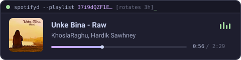

  <!-- Scalable macOS Terminal Window -->
  

    

  <!-- Row 1: High-Contrast Connect Badges -->
  

    &nbsp;
    &nbsp;
    &nbsp;
    
  

   

  <!-- Tech Stack Row 1: Core & Web -->
  

    &nbsp;
    &nbsp;
    &nbsp;
    &nbsp;
    &nbsp;
    
  

  <!-- Tech Stack Row 2: Systems, Cloud & Quantum -->
  

    &nbsp;
    &nbsp;
    &nbsp;
    &nbsp;
    
  

   

  <!-- Live Cycling Spotify Playlist Widget -->
  

    

  <!-- Theme-Aware Contribution Snake -->
  <picture>
    <source media="(prefers-color-scheme: dark)" srcset="https://raw.githubusercontent.com/codyandersan/codyandersan/output/snake-dark.svg?v=5" />
    <source media="(prefers-color-scheme: light)" srcset="https://raw.githubusercontent.com/codyandersan/codyandersan/output/snake-light.svg?v=6" />
    
  </picture>

